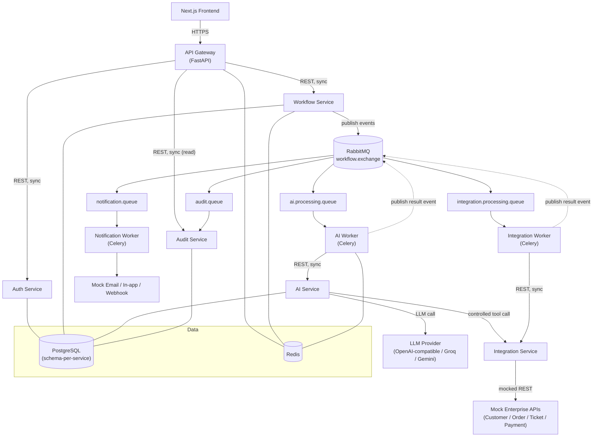
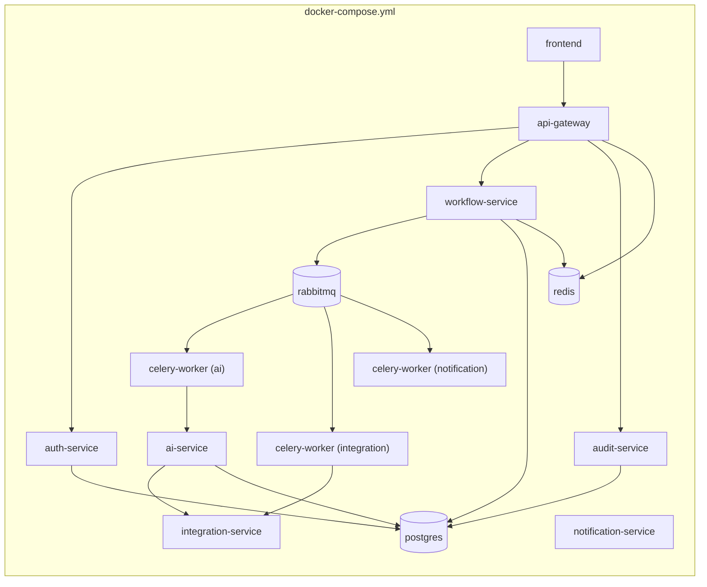

# Enterprise AI Workflow & Automation Platform
## Phase 1 — Architecture & Repository Setup

This is Project 3 in your AI engineering portfolio. Projects 1 and 2 proved you can build RAG systems and AI workflows *inside* one FastAPI app. Project 3 proves something different and, for an AI Backend Engineer interview, more valuable: **you can put AI inside a real distributed system** — one where the LLM is a replaceable component, not the architecture.

Everything below is Phase 1 only: architecture, contracts, and repo skeleton. No business logic yet. We stop at the end and you confirm before any service gets real code.

---

## 1. Complete Architecture Diagram



**How to read this:** the Gateway is the only thing the frontend talks to. Everything past the Gateway either talks over plain REST (when the caller needs an answer *now*, e.g. "give me this workflow's status") or over RabbitMQ (when the work is long-running or can be decoupled, e.g. "go run this AI step"). Workers are the only thing that "do" long-running work; services own data and expose APIs.

---

## 2. Service Responsibilities

| Service | Owns | Does NOT do |
|---|---|---|
| **API Gateway** | Public entry point, JWT verification, request/correlation IDs, rate limiting, routing, unified error format | Business logic, database access |
| **Auth Service** | Users, credentials, roles/permissions, JWT issuance & refresh, token revocation | Workflow logic, AI logic |
| **Workflow Service** | Workflow definitions, versions, executions, step state, approvals (the state machine) | Calling the LLM directly, calling external APIs directly |
| **AI Service** | LLM provider abstraction, prompt management, structured output validation, LangGraph execution, token/cost tracking | Executing side-effecting actions (refunds, etc.) itself |
| **Integration Service** | Controlled access to external/mock APIs (customer, order, ticket, payment), idempotency for side-effecting calls | Deciding *whether* to act — it only executes what it's told |
| **Notification Service** | Email/in-app/webhook delivery abstraction | Business decisions |
| **Audit Service** | Immutable event log, audit query API | Being writable by anything except event consumption |

Each service is a reason to look something up in an interview: *"why does Integration Service, not AI Service, own the refund call?"* → because the LLM must never be the thing that directly executes a side effect; it recommends, a controlled service executes.

---

## 3. Communication Matrix

| From → To | Pattern | Why |
|---|---|---|
| Frontend → API Gateway | HTTP/REST (sync) | Single public entry point |
| Gateway → Auth Service | HTTP/REST (sync) | Login/token verification needs an immediate answer |
| Gateway → Workflow Service | HTTP/REST (sync) | CRUD + status reads need an immediate answer |
| Gateway → Audit Service | HTTP/REST (sync, read-only) | Querying logs is a read, not a workflow |
| Workflow Service → RabbitMQ | Async publish | Starting AI/integration/notification work shouldn't block the HTTP request |
| RabbitMQ → Celery Workers | Async consume | Workers process at their own pace, can scale horizontally, can retry |
| AI Worker → AI Service | HTTP/REST (sync) | The worker needs the LLM's structured result back before deciding next step |
| Integration Worker → Integration Service | HTTP/REST (sync) | Needs the mocked API's response synchronously to report success/failure |
| AI Service → Integration Service | HTTP/REST (sync, tool call) | A controlled tool call, not a direct DB or HTTP call from the LLM |
| Workers → RabbitMQ | Async publish (result events) | Workflow Service consumes these to advance the state machine |
| Any service → Audit Service | Async via `audit.queue` | Audit writes must never block or fail the primary operation |

Rule of thumb you should be able to say out loud in an interview: **sync when the caller needs the answer to proceed right now; async when the work can be decoupled, retried, or is long-running.**

---

## 4. Database Ownership Matrix

| Service | Postgres schema | Key tables |
|---|---|---|
| Auth Service | `auth` | `users`, `roles`, `permissions`, `refresh_tokens` |
| Workflow Service | `workflow` | `workflows`, `workflow_versions`, `workflow_steps`, `workflow_executions`, `step_executions`, `approvals`, `execution_events` |
| AI Service | `ai` | `ai_requests`, `ai_responses`, `model_configurations`, `token_usage`, `cost_records` |
| Audit Service | `audit` | `audit_events` |

- One Postgres **instance** for local dev simplicity, but **one schema per service** — no service is allowed to query another's schema directly.
- Integration Service and Notification Service are stateless-ish for this project (mock APIs have their own tiny in-memory/SQLite store) — they don't need a dedicated production schema unless you want to persist idempotency keys, which you should (see §20 of your spec) — we'll give Integration Service a small `integration` schema for that (`idempotency_keys`, `mock_customers`, `mock_orders`, `mock_tickets`, `mock_payments`).
- Cross-service data needs (e.g. Workflow Service wanting a user's name) are satisfied by **calling the owning service's API**, never by joining across schemas.

---

## 5. Event Architecture

**Exchange:** `workflow.exchange` (topic exchange)

| Routing key | Published by | Consumed by |
|---|---|---|
| `workflow.created` | Workflow Service | Audit Service |
| `workflow.started` | Workflow Service | AI Worker, Audit Service |
| `workflow.step.started` | Workflow Service | Audit Service |
| `workflow.step.completed` | Workers | Workflow Service, Audit Service |
| `workflow.step.failed` | Workers | Workflow Service, Audit Service |
| `ai.requested` | Workflow Service | AI Worker |
| `ai.completed` | AI Worker | Workflow Service, Audit Service |
| `integration.requested` | Workflow Service / AI Service | Integration Worker |
| `integration.completed` | Integration Worker | Workflow Service, Audit Service |
| `approval.requested` | Workflow Service | Notification Worker, Audit Service |
| `approval.completed` | Workflow Service | Audit Service |
| `notification.requested` | Workflow Service | Notification Worker |
| `workflow.completed` | Workflow Service | Audit Service |
| `workflow.failed` | Workflow Service | Audit Service |

**Queues (durable, bound by routing key):**
`workflow.execution.queue`, `ai.processing.queue`, `integration.processing.queue`, `notification.queue`, `audit.queue` — each with a matching `*.dlq` dead-letter queue and a `*.retry` queue (TTL-based, republishes to the original queue on expiry — the classic RabbitMQ retry-without-a-scheduler pattern).

**Event envelope (versioned):**

```json
{
  "event_id": "uuid",
  "event_type": "workflow.started",
  "event_version": 1,
  "timestamp": "2026-09-19T10:00:00Z",
  "correlation_id": "uuid",
  "workflow_id": "uuid",
  "execution_id": "uuid",
  "payload": {}
}
```

`event_id` is what makes consumers idempotent (store processed IDs, skip duplicates). `correlation_id` is what makes the whole execution traceable across every service's logs.

---

## 6. Repository Structure

```
enterprise-ai-platform/
├── services/
│   ├── api-gateway/
│   ├── auth-service/
│   ├── workflow-service/
│   ├── ai-service/
│   ├── integration-service/
│   ├── notification-service/
│   └── audit-service/
├── workers/
│   ├── ai-worker/
│   ├── integration-worker/
│   └── notification-worker/
├── frontend/
├── infrastructure/
│   ├── docker/
│   ├── rabbitmq/
│   ├── postgres/
│   └── monitoring/
├── shared/
│   ├── event_contracts/      # pydantic models for every event type + envelope
│   ├── logging/              # structured JSON logger, request/correlation ID middleware
│   ├── exceptions/           # domain exception base classes + error envelope
│   └── utilities/            # small, genuinely shared helpers only
├── tests/
│   ├── integration/
│   └── e2e/
├── docs/
│   ├── architecture/
│   ├── api/
│   ├── workflows/
│   └── decisions/            # ADRs
├── docker-compose.yml
├── .env.example
├── README.md
└── Makefile
```

Each service under `services/` and `workers/` is its own Python package with its own `pyproject.toml`/`requirements.txt`, its own Dockerfile, and its own `app/` (routers, schemas, services, repositories, models). `shared/` stays intentionally thin — event contracts and logging conventions, not business logic. If you ever find yourself importing business logic from `shared/` into two services, that's a sign a service boundary is wrong.

---

## 7. Technology Choices (with the "why" you'll be asked in interviews)

| Choice | Why this and not the alternative |
|---|---|
| **FastAPI** | Native async, Pydantic v2 integration, automatic OpenAPI — you already know it from Projects 1–2, so Project 3 can focus on distributed-systems concepts instead of relearning a framework |
| **RabbitMQ over Kafka** | This project needs task-style routing, retries, and dead-lettering, not high-throughput log streaming or replay. RabbitMQ's exchange/routing-key model maps directly onto the event list above. You'll still be asked "why not Kafka" — answer: Kafka wins for event replay/streaming analytics at scale; RabbitMQ wins for per-message routing, priority, and DLQ semantics at this scale |
| **Celery over asyncio background tasks** | Need real retry/backoff, worker scaling, and visibility into task state — FastAPI `BackgroundTasks` doesn't survive a process restart or scale independently |
| **Redis** | Cache, rate-limit counters, short-lived execution state, distributed locks — never the system of record |
| **PostgreSQL, schema-per-service** | Relational integrity within a service, physical separation without running N database instances locally |
| **SQLAlchemy 2.x (async) + Alembic** | Typed, async-native ORM with mature migrations |
| **LangGraph** | Only for the AI reasoning workflow (intent → plan → tool selection → validation → decision). Deterministic steps (lookups, notifications) stay as plain Python — LangGraph is not a replacement for a state machine you don't need |
| **Provider-abstracted LLM layer** | `LLMProvider` interface with OpenAI-compatible/Groq/Gemini implementations, so swapping a provider is a config change, not a rewrite |
| **Next.js + TypeScript** | Matches Projects 1–2, keeps focus on backend architecture |

---

## 8. Development Roadmap (Phases)

You already have the 25-phase plan in your spec (Architecture → Docker → Gateway → Auth → Workflow Service → Postgres → RabbitMQ → Celery → Redis → Integration → Mock APIs → AI Service → LLM abstraction → LangGraph → Human approval → Notification → Audit → Observability → Frontend → Testing → Failure testing → Performance → Security → Docker prod → Docs). We follow it exactly, one phase at a time, and I won't jump ahead.

**Next up after this document is confirmed:** Phase 2 — Docker infrastructure (empty service skeletons + Postgres/Redis/RabbitMQ containers wired together, nothing "working" yet, just booting and health-checking).

---

## 9. Docker Architecture (target shape, built out in Phase 2 & 24)



Local dev runs everything via `docker compose up`, each service with its own Dockerfile, `depends_on` + healthcheck conditions (don't let Auth Service start accepting traffic before Postgres is actually ready). Kubernetes is explicitly out of scope for v1 — documented as a future improvement, not built.

---

## 10. First Implementation Steps (what Phase 2 will actually create)

1. `docker-compose.yml` with `postgres`, `redis`, `rabbitmq` (with management UI), each with healthchecks.
2. `infrastructure/postgres/init.sql` to create the four schemas (`auth`, `workflow`, `ai`, `audit`, `integration`).
3. Empty FastAPI skeletons for all 7 services + 3 workers, each with `/health` returning `{"status": "ok", "service": "<name>"}` — no `/ready` yet (that needs real dependency checks, added once each service has a dependency to check).
4. `.env.example` with every variable listed in §32 of your spec.
5. `shared/logging/` — one structured JSON logger + request-ID/correlation-ID middleware, imported (not duplicated) by every service.
6. A root `Makefile` with `make up`, `make down`, `make logs`, `make test`.

---

## What you should understand before Phase 2

- Why the Gateway is the *only* public entry point, and why services still re-check authorization even though the Gateway already checked authentication.
- Why Workflow Service publishes events instead of calling AI Service directly.
- Why schema-per-service (not database-per-service, for local simplicity) is "good enough" isolation here, and what you'd change for true production isolation.
- The difference between a **routing key**, an **exchange**, and a **queue** — you'll be asked this directly.
- Why LangGraph is scoped to *only* the AI reasoning path, not the whole workflow engine.

**Interview questions to be ready for after this phase:**
1. Why microservices here, and when would you *not* reach for microservices?
2. Walk through what happens end-to-end when a workflow execution starts — which calls are sync, which are async, and why.
3. What's the difference between at-least-once delivery and exactly-once processing, and where does idempotency come in?
4. Why does the LLM never call the Integration Service's mock payment API directly?
5. Why schema-per-service instead of one shared schema, and what breaks if you skip this?

---

Confirm this architecture (or tell me what to change) and I'll start **Phase 2 — Docker Infrastructure** next, building only that phase.
